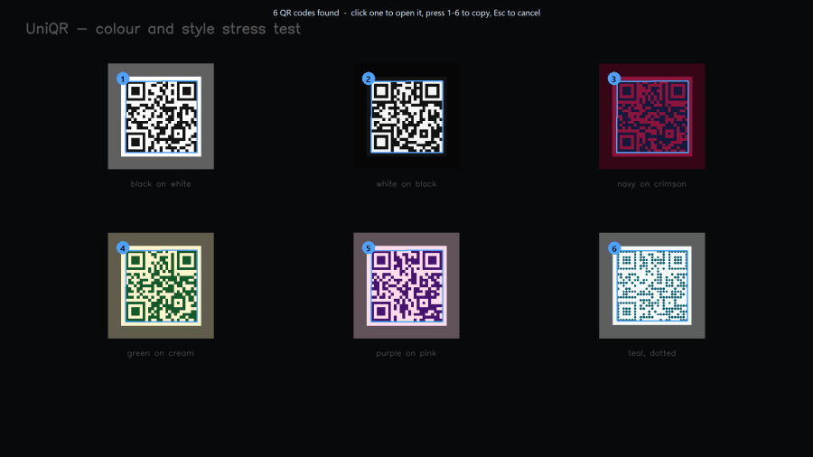

# UniQR

Read any QR code on your screen with one keypress. No phone needed.



[](https://github.com/pat-selby/uniqr/actions/workflows/ci.yml)

## Get it

**Windows**

1. Download `UniQR.exe` from the [latest release](https://github.com/pat-selby/uniqr/releases/latest).
2. Double-click it. If Windows says "Windows protected your PC", click **More info**, then **Run anyway**.
3. Press ** + Shift + Q** on any QR code.

**Linux** (X11): download `UniQR-linux-x86_64`, run `chmod +x UniQR-linux-x86_64`, then `./UniQR-linux-x86_64`. Press **Ctrl + Alt + Q**.

**Mac** (macOS 14+): download `UniQR-macOS-arm64.dmg` (Apple Silicon) or `UniQR-macOS-x86_64.dmg` (Intel), drag UniQR to Applications, then open it. The first time, click **Open Anyway** in System Settings → Privacy & Security. Press **⌘ Cmd + Shift + 8**. See [INSTALL.md](INSTALL.md#macos).

Full steps and fixes for each system: [INSTALL.md](INSTALL.md).

## Use it

| On screen | UniQR |
|---|---|
| One code | Copies it and shows a card with an **Open** button |
| Several codes | Dims the screen and numbers them. Hover, click, or press 1 to 9 |
| No code | Says so, briefly |

To quit, right-click the tray icon and choose **Exit**. To report a bug, choose **Report a problem**.

## Safety

A QR code is a stranger's text, so UniQR treats it with care:

- Only `http` and `https` links get an **Open** button. Wi-Fi passwords, contacts and app links are copy-only.
- The card warns about plain `http`, the `@` trick, lookalike letters and raw IP addresses.
- It looks at the screen only when you press the hotkey.
- What you scan never leaves your computer. It only goes online if you turn on the daily update check.

## What it reads

QR codes, plus Micro QR, rMQR, Data Matrix, Aztec, PDF417 and MaxiCode. It handles dark mode, tilted and styled codes, and several codes at once. It ignores the striped barcodes on products on purpose.

## How well it reads

On 1,064 generated codes, each damaged in a known way, UniQR read **96.8%**, with **0 wrong answers** and **0 false alarms** on 48 images with no code. Full table: [benchmarks/RESULTS.md](benchmarks/RESULTS.md).

## For developers

```bash
pip install -e ".[dev]"     # add [windows] on Windows
uniqr                       # run the app
uniqr-scan photo.png        # read codes from an image file
pytest                      # 498 tests
```

- **How it works:** a hotkey triggers a screen capture, then a retry ladder of image steps and three decoders (OpenCV's two QR readers and zxing-cpp). Only capture, hotkey, tray and clipboard differ per system, behind `uniqr/backends/`.
- **C++ version:** [`cpp/`](cpp/README.md) is a port of the scanner and Windows app to C++20, with no OpenCV. It's one 1.9 MB file and is offered as a preview in each release.
- **More:** [DEVELOPMENT.md](DEVELOPMENT.md) for notes and history, [CODE_SIGNING_POLICY.md](CODE_SIGNING_POLICY.md) for why Windows warns.

MIT licensed.
